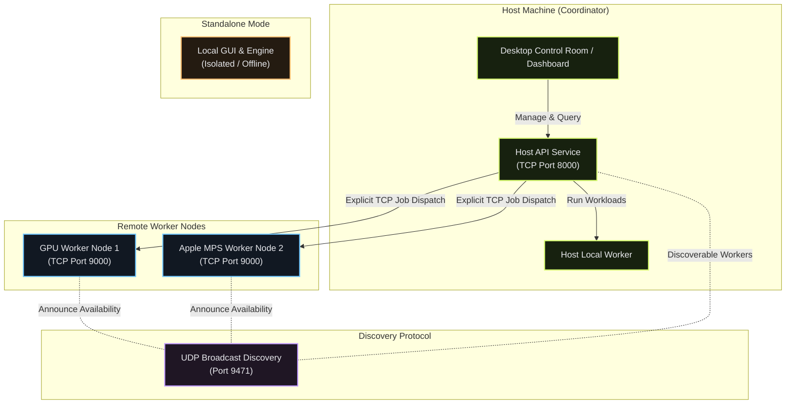

# HAR Runtime

**HAR (Hardware-Aware Runtime)** is a high-performance compute workspace designed for running repeatable, hardware-aware AI benchmarks across **CPU**, **Apple MPS**, and **NVIDIA CUDA** devices.

HAR operates as a standalone execution environment or as a LAN compute cluster—offering a desktop visual control room alongside a headless CLI (`har`) for automation, remote workers, and headless servers.

---

## Architecture & System Flow

HAR turns local area network (LAN) machines into an explicit compute fabric without implicit or silent background execution.



### Benchmark Execution Pipeline

```mermaid
flowchart LR
    classDef initStyle fill:#1a1d24,stroke:#89929e,stroke-width:1.5px,color:#e8e9ed;
    classDef validateStyle fill:#1f1624,stroke:#c29cff,stroke-width:1.5px,color:#e8e9ed;
    classDef execStyle fill:#17210f,stroke:#d9ff72,stroke-width:2px,color:#e8e9ed;
    classDef resultStyle fill:#111822,stroke:#71c8ff,stroke-width:1.5px,color:#e8e9ed;
    classDef errStyle fill:#24150f,stroke:#ff9f72,stroke-width:1.5px,color:#e8e9ed;

    Start([Start Benchmark Run]):::initStyle --> DetectHw[Detect Hardware & Memory]:::initStyle
    DetectHw --> CheckBackend{Backend Available?}:::validateStyle

    CheckBackend -- No --> FailRun[Fail with Explicit Reason]:::errStyle
    CheckBackend -- Yes --> Warmup[Run Warmup Iterations]:::execStyle

    Warmup --> MeasuredRun[Execute Measured Iterations]:::execStyle
    MeasuredRun --> Verify[Verify Tensor Correctness]:::execStyle

    Verify --> RecordMetrics[Calculate Latency, Throughput & RTT]:::resultStyle
    RecordMetrics --> Export[Export Results JSON / CSV / UI]:::resultStyle
```



---

## User Guide

### 1. Desktop Application Control Room

The packaged Desktop Application provides a visual control room for monitoring hardware, dispatching benchmarks, and analyzing metrics. It ships with a self-contained runtime environment—**no Python, Rust, or Node.js installation is required**.

#### Operating Modes
| Mode | Description | LAN Visibility |
| :--- | :--- | :--- |
| **Host** *(Default)* | Exposes the coordinator service to the LAN and manages local/remote benchmark execution. | Fully visible & listens for remote workers. |
| **Worker** | Keeps the dashboard local and advertises this machine as a discoverable worker node for a Host. | Advertises worker presence on UDP `9471`. |
| **Standalone** | Keeps all services, engine execution, and dashboards strictly local. | Fully offline / Isolated. |

> **Explicit Connection Policy**: HAR never automatically connects to discovered workers. Host operators must manually select and request connections to remote workers.

---

### 2. Supported Workloads & Benchmarks

HAR tests compute performance across deterministic tensor workloads:

| Workload | Backend Options | Primary Metric | Description |
| :--- | :--- | :--- | :--- |
| **`matmul`** | `cpu`, `mps`, `cuda` | **TFLOP/s** | Seeded dense matrix multiplication (`N x N` FP32 matrices). |
| **`image`** | `cpu`, `mps`, `cuda` | **images/second** | Seeded CNN tensor-backed inference workload. |
| **`tree`** | `cpu`, `mps`, `cuda` | **traversals/second** | Seeded tensor-backed tree structure traversal. |

Each benchmark execution records:
- **Hardware Profile**: Device name, memory capacity (measured/estimated), and backend capabilities.
- **Latency**: Min, max, median, and iteration distributions in seconds.
- **Throughput**: Calculated compute throughput based on workload size.
- **Network RTT**: Measured round-trip latency when executing jobs on remote workers.
- **Correctness**: Pass/Fail assertion using reference computations.

---

## HAR CLI

The `har` command-line tool enables headless benchmark runs, automated scripts, and remote worker node provisioning.

### Installation

Install `har` in a Python virtual environment or using `pipx`:

```bash
# Option 1: Virtual Environment
python3 -m venv .venv
source .venv/bin/activate
python -m pip install --upgrade pip
python -m pip install .

# Option 2: Isolated installation with pipx
pipx install .
```

---

### CLI Command Reference

#### Hardware Discovery
Inspect local hardware capabilities and memory availability across `cpu`, `mps`, and `cuda`:

```bash
har devices
```

*Sample Output:*
```text
cpu: available | 13th Gen Intel(R) Core(TM) i9-13900K
  memory available: 67108864000 bytes (measured)
cuda: available | NVIDIA GeForce RTX 4090
  memory available: 25757220864 bytes (measured)
mps: unavailable | Apple Silicon MPS unsupported on Linux
  reason: MPS backend requires macOS with Apple Silicon
```

---

#### Running Local Benchmarks

##### 1. Dense Matrix Multiplication (`matmul`)
```bash
# Basic CPU benchmark
har benchmark matmul --size 2048 --backend cpu

# Run on NVIDIA CUDA with warmups, iterations, seed, and JSON output
har benchmark matmul \
  --size 4096 \
  --backend cuda \
  --warmup 5 \
  --iterations 20 \
  --seed 1337 \
  --json results/cuda_run.json \
  --csv results/cuda_run.csv
```

##### 2. Image Inference Workload (`image`)
```bash
har benchmark image --backend cuda --batch-size 16 --image-size 64
```

##### 3. Tree Traversal Workload (`tree`)
```bash
har benchmark tree --backend cpu --depth 14 --traversals 8192
```

---

#### Cluster & Remote Worker Commands

##### Discover Workers on Network
Scan the LAN for available HAR worker nodes via UDP broadcast:
```bash
har discover
```

##### Start a LAN Host (Coordinator)
Start a coordinator node accessible to LAN workers:
```bash
har host \
  --host 0.0.0.0 \
  --port 8000 \
  --advertise-url http://192.168.1.10:8000
```

##### Start a Remote Worker Node
Run a headless machine as an available worker waiting for host connections:
```bash
har worker \
  --host 0.0.0.0 \
  --port 9000 \
  --advertise-url http://192.168.1.20:9000 \
  --name gpu-worker-01
```

##### Register Worker Directly to Coordinator
Provision a worker node that registers immediately with a specific host:
```bash
har worker \
  --coordinator http://192.168.1.10:8000 \
  --advertise-url http://192.168.1.20:9000 \
  --name gpu-node-02 \
  --node-id gpu-node-02
```

##### Explicitly Connect Host to Worker
Initiate connection from host to worker without the web dashboard:
```bash
har connect \
  --host http://192.168.1.10:8000 \
  --worker http://192.168.1.20:9000 \
  --name gpu-worker-01
```

##### Disable Worker Consent (Visible but Deny Join Requests)
```bash
har worker \
  --advertise-url http://192.168.1.20:9000 \
  --deny-connections
```

---

## Networking & Security

HAR uses targeted protocols for network communication:

| Protocol | Port | Purpose |
| :--- | :--- | :--- |
| **UDP Broadcast** | `9471` | Fast, connectionless LAN worker discovery. (Never carries benchmark data or results). |
| **TCP / HTTP** | `8000` | Host Coordinator API, dashboard communications, heartbeats, and job orchestration. |
| **TCP / HTTP** | `9000` | Worker join endpoints, benchmark job execution, and metric result polling. |

### Firewall Configuration
When operating across multiple physical nodes:
- **Windows**: Allow incoming/outgoing traffic for UDP `9471`, Host TCP `8000`, and Worker TCP `9000`.
- **Linux (`ufw`)**:
  ```bash
  sudo ufw allow 9471/udp
  sudo ufw allow 8000/tcp
  sudo ufw allow 9000/tcp
  ```

> **Security Note**: Use HAR within trusted local networks. Authentication, encryption, and multi-tenant job isolation are not included in the current version.

---

## Development & Testing

### Running Tests
Execute the Python test suite:
```bash
python3 -m pytest
```

### Dashboard Development
Run the Host API alongside the frontend dev server:

```bash
# Terminal 1: Start Host API
har host --host 0.0.0.0 --advertise-url http://127.0.0.1:8000

# Terminal 2: Start Vite Dev Server
cd web
npm ci
npm run dev
```

### Packaging Desktop Installers
Build the desktop app shell using Tauri and PyInstaller:

```bash
cd web
npm run desktop:build
```

- **macOS**: Generates bundle installers containing embedded macOS Python runtime binaries.
- **Windows**: Generates an Inno Setup installer containing CUDA-enabled executable runtimes.
