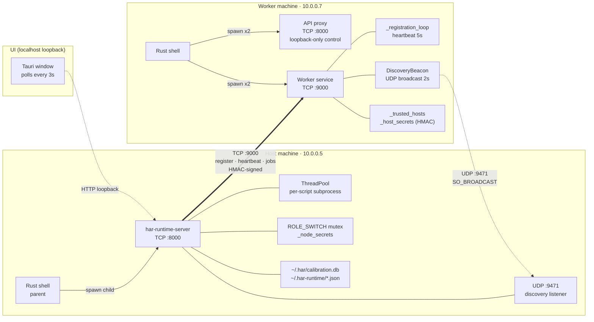
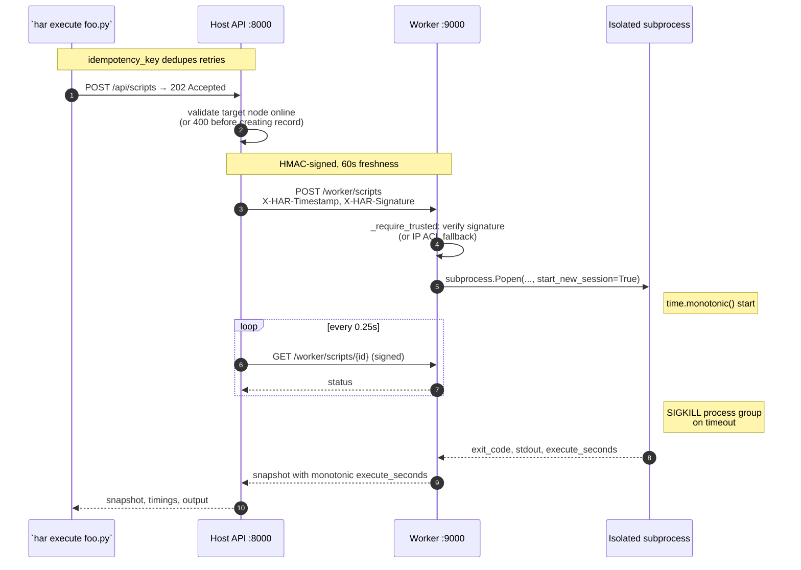

# HAR Runtime

A Python runtime that routes individual function calls across the devices on your
personal LAN. Decorate a function with `@har.offload`, run your script with `har
execute`, and HAR picks the device per call based on measured latency and transfer
cost — CPU on your laptop, MPS on a Mac, CUDA on a Windows gaming rig, whatever
is cheapest for the inputs you handed it.

HAR is a *dispatcher*, not a compiler. It assumes you already know how to write
PyTorch / numpy / arbitrary Python. It handles **where** the work runs.

> **Not Ray, not Dask, not Modal.** Those assume a cluster or cloud account. HAR
> assumes two to five personal machines on the same Wi-Fi. One liner install,
> no DevOps, no YAML.

---

## Install

One `pip install har` gets you everything — the `@har.offload` SDK, the
host/worker services as a subpackage, and the `har` CLI. The desktop app is a
separate installer because it bundles a Rust shell + React UI.

```bash
pip install -e har/          # SDK + services + `har` CLI
# or from PyPI once 1.x stabilises:  pip install har
```

For the desktop app, download the installer from
[GitHub Releases](https://github.com/RisheekeshKG/Hardware-Aware-Heterogeneous-AI-Runtime/releases)
or build it from source (see **Development** below).

### Desktop app (host or worker, with a UI)

Download the installer for your OS from
[GitHub Releases](https://github.com/RisheekeshKG/Hardware-Aware-Heterogeneous-AI-Runtime/releases).
First launch pulls the matching bundled runtime (~160 MB), so no Python install is
needed on worker machines.

| Platform | File | Notes |
|---|---|---|
| macOS (Apple Silicon) | `HAR Runtime_1.0.0_aarch64.dmg` | Not notarised yet — right-click → Open on first launch |
| Windows (x64) | `HAR_Setup_1.0.0.exe` | SmartScreen will warn until code signing is in place |
| Linux (x64) | Build locally via `npm run desktop:build` | Not yet released |

---

## Quick start

### 1. One machine, your Python script

```python
# demo.py
import torch
import har

@har.offload
def matmul(size: int) -> torch.Tensor:
    L = torch.randn(size, size)
    R = torch.randn(size, size)
    return L @ R

print(matmul(2048).shape)
```

```bash
har execute demo.py
```

HAR times the call on each available backend (CPU, MPS, CUDA), caches the
measurements per argument shape in `~/.har/calibration.db`, and picks the
cheapest device for next time. On exit it prints the routing decisions:

```
__main__.matmul: mps (Apple MPS) in 112.89 ms — cheapest measured option
```

### 2. Two machines on your LAN

- **Machine A** (your Mac): open the desktop app → **Devices → Role → Host**.
- **Machine B** (your Windows PC with the 3050): open the app → **Devices →
  Role → Worker**. Copy its LAN address, e.g. `http://192.168.1.42:9000`.
- On A: **Devices → Add device** → paste the address, click **Connect**. Or let
  LAN broadcast find B automatically and click **Connect** on the discovered row.
- On B: the Accept/Decline prompt appears. Click **Accept**.

A can now offload work to B. From any script running on A:

```python
import har

@har.offload           # Default policy: router picks between local CPU/MPS and B's CUDA
def embed(docs): ...
```

A per-shape calibration cache fills in after a few calls; from then on HAR
submits the batch to whichever device has the lowest measured latency plus
estimated transfer cost over the LAN.

---

## Core concepts

### Roles

Every HAR install is in one of three roles at a time:

| Role | What it does | Which ports are bound |
|---|---|---|
| **Host** | Dispatches work. Keeps the roster of connected workers. Owns the SDK's router. | `:8000` (API) |
| **Worker** | Accepts jobs from accepted hosts. Runs them in an OS-isolated subprocess with a timeout. | `:8000` (API, loopback-only control), `:9000` (worker service) |
| **Standalone** | Local-only; no LAN exposure. For when you just want the SDK on one laptop. | `:8000` (API, loopback-only) |

Role switches use a mutex-guarded `stop → spawn` cycle so overlapping clicks
can't leave orphan processes.

### Placement policy

Per-call routing uses this cost model:

```
cost(device, call) = measured_latency(device, shape) + transfer_bytes / bandwidth(device)
```

- First call for a given `(function, shape)` pair runs on the current device and
  records a sample.
- Subsequent calls pick the device with minimum cost. Hysteresis (10% default)
  prevents thrashing when two devices are nearly tied.
- Transfer bandwidth is approximated per-link: ~12 GB/s for CUDA (PCIe), ~40 GB/s
  for MPS (unified memory), gigabit for LAN.

Cache lives at `~/.har/calibration.db`. Blow it away to reset.

### Trust and auth

- Pairing is **human-gated**: a worker only accepts a host after the person at
  the worker machine clicks Accept.
- Accepted hosts land in `~/.har-runtime/trusted-hosts.json`. The worker's UI
  shows every trusted host and offers a per-host **Revoke** button.
- Every host→worker request is **HMAC-signed** with a per-host secret the worker
  minted on accept. 60-second freshness window, constant-time compare. See
  [`src/har_runtime/signing.py`](src/har_runtime/signing.py).
- Pre-HMAC hosts fall back to IP-based ACL so a mixed-version LAN keeps working
  during rollout. New installs always use HMAC.

### Script isolation

User scripts run in a dedicated OS subprocess, not a thread. That means:

- A crashing or hanging script can only harm its own process.
- Timeouts are enforced via `SIGKILL` on the whole process group (POSIX
  `killpg`, Windows `taskkill /F /T`) — grandchildren get killed too.
- Duration measurements come from `time.monotonic()` inside the subprocess, so
  wall-clock skew between host and worker can't poison the "Remote execute" number.
- Default timeout is 10 min; override per-run with `timeout_seconds` on the
  `ScriptRunRequest`.

---

## Architecture



### Script execution lifecycle



---

## Hardware support

| Backend | Runtime availability check | Memory source | Utilization probe |
|---|---|---|---|
| **CPU** | Always | `psutil.virtual_memory()` | `psutil.cpu_percent()` |
| **Apple MPS** | `torch.backends.mps.is_available()` | `torch.mps.recommended_max_memory()` minus `current_allocated_memory()` | *Not exposed by Apple without `sudo powermetrics`* |
| **NVIDIA CUDA** | `torch.cuda.is_available()` | `torch.cuda.mem_get_info()` | `pynvml.nvmlDeviceGetUtilizationRates()` with `nvidia-smi` fallback |

CPU detection reads the real brand and max frequency on each OS:

- macOS: `sysctl machdep.cpu.brand_string` + `hw.cpufrequency_max`
- Linux: `/proc/cpuinfo` `model name` + `cpu MHz`
- Windows: `Win32_Processor.Name` + `.MaxClockSpeed` (wmic first, PowerShell
  `Get-CimInstance` fallback for Windows 11 24H2+)

---

## CLI reference

```bash
har devices                           # list CPU/MPS/CUDA on this machine
har execute script.py [-- args]       # run script with SDK pre-loaded, print routing decisions
har host --advertise-url ...          # start as host
har worker --coordinator ...          # start as worker, auto-register with host
har discover                          # one-shot LAN scan
har connect --host ... --worker ...   # pair without the UI
har benchmark matmul --size 4096 --backend cuda   # built-in micro-benchmarks (dev tool)
```

`har --help` and `har <command> --help` have the full option list.

---

## Environment parity

Workers refuse jobs they can't actually run — or at least surface the mismatch
before the user wonders why nothing happened. The host can call
`/api/nodes/{id}/env-hash` and get:

```json
{
  "host":   { "python": "3.12.9", "packages": {"torch": "2.14.1", ...}, "hash": "..." },
  "worker": { "python": "3.12.9", "packages": {"torch": "2.11.0", ...}, "hash": "..." },
  "mismatches": ["torch: 2.14.1 / worker 2.11.0"],
  "compatible": false
}
```

HAR checks:
- Python major.minor.patch
- `torch`, `numpy`, `psutil`, `fastapi`, `uvicorn`, `httpx`, `pydantic`, `pynvml`

Future: block dispatch when `compatible == false` instead of just warning. Open
to feedback on which other packages should land in the key set.

---

## Development

```bash
python -m venv .venv
source .venv/bin/activate              # or .venv\Scripts\activate on Windows
pip install -e "har/[test]"             # SDK + services + test deps
cd har && pytest                        # 55 tests, ~3s
```

### Desktop app from source

```bash
cd desktop
npm ci
npm run desktop:dev                     # live-reload (spawns backend + Rust shell + Vite)
npm run desktop:build                   # produce installer in src-tauri/target/release/bundle/
```

### CI

[`.github/workflows/ci.yml`](.github/workflows/ci.yml) runs on every PR + push
to `main`:

- `pytest` matrix: ubuntu / macos / windows × py3.11 / py3.12
- `vite build` on linux
- `cargo check --no-default-features` on all three OSes

Specifically catches cross-platform drift in `subprocess_runner` (POSIX `killpg`
vs Windows `taskkill`) and `env_hash` (importlib.metadata behavior differs in
frozen PyInstaller bundles).

---

## Status

### Working

- `@har.offload` SDK with per-shape calibration + hysteresis
- `har execute` CLI
- Host/Worker/Standalone roles, mutex-serialized switching
- LAN discovery via UDP broadcast, discovered-vs-connected dedupe
- Human-approved pairing, trusted-host revoke, HMAC-signed requests
- Subprocess isolation, SIGKILL-tree on timeout, monotonic durations
- Idempotency keys on script submission
- Desktop app: scripts-first UI, device inventory, routing decisions, timing breakdown

### Deliberately not yet

| Gap | Why it's not shipped yet |
|---|---|
| Durable job queue | Scheduled; schema change is isolated to its own PR |
| Code-signed installers | Needs paid Apple Developer ID + Windows EV cert |
| SSE/WebSocket stdout streaming | Current polling is fine for scripts under ~5 min; longer-running work gets this next |
| mDNS discovery | UDP broadcast doesn't cross subnets; mDNS does, planned |
| Multi-host coordination | HAR assumes one host, many workers; multi-host election is out of scope for 1.x |

### Won't do

- Kubernetes integration. If you're at K8s scale you want
  [NVIDIA KAI Scheduler](https://github.com/NVIDIA/KAI-Scheduler), not HAR.
- Cloud offload. HAR is for machines you own.

---

## Networking summary

| Protocol | Port | Scope | Purpose |
|---|---|---|---|
| UDP | 9471 | LAN broadcast | Service discovery; never carries job data |
| TCP | 8000 | LAN (host), loopback (worker/standalone) | Host API, UI, control plane |
| TCP | 9000 | LAN | Worker jobs. HMAC-signed from paired hosts |

### Firewall

- **Linux** (`ufw`): `sudo ufw allow 9471/udp && sudo ufw allow 8000/tcp && sudo ufw allow 9000/tcp`
- **Windows**: allow inbound on UDP 9471, TCP 8000, TCP 9000
- **macOS**: no action needed by default

---

## Project layout

```
HAR-Runtime/
├── har/                              # pip install har — the whole Python package
│   ├── pyproject.toml                #   name = "har"
│   ├── har-runtime-server.spec       # PyInstaller spec for the desktop bundle
│   ├── src/har/
│   │   ├── __init__.py               # public SDK: offload, devices, map, where_did_it_run
│   │   ├── decorator.py              # @offload wrapper + decision log
│   │   ├── router.py                 # cost model + hysteresis + per-shape key
│   │   ├── calibration.py            # SQLite cache for measured latencies
│   │   ├── execute.py                # moves tensors, runs, pulls result back
│   │   ├── inventory.py              # discovers CPU/MPS/CUDA via torch
│   │   └── runtime/                  # the host + worker services, as a subpackage
│   │       ├── __init__.py
│   │       ├── api.py                # Host API (FastAPI, :8000)
│   │       ├── worker.py             # Worker service (FastAPI, :9000)
│   │       ├── cli.py                # `har` command (typer)
│   │       ├── subprocess_runner.py  # OS-isolated script run + kill-tree
│   │       ├── signing.py            # HMAC request signing
│   │       ├── env_hash.py           # Env parity fingerprint
│   │       ├── discovery.py          # UDP broadcast beacon + listener
│   │       ├── devices.py            # CPU/MPS/CUDA probe
│   │       ├── benchmark.py          # Built-in dev-tool benchmarks
│   │       └── models.py             # Shared dataclasses
│   └── tests/                        # 55 tests
│
├── desktop/                          # the Tauri desktop app (Rust shell + React UI)
│   ├── src-tauri/                    # Rust Tauri shell
│   ├── src/                          # React UI
│   ├── index.html
│   ├── package.json
│   └── vite.config.js
│
├── scripts/                          # offload_demo.py, resource_probe.py
├── docs/style.md                     # UI style guide
├── .github/workflows/ci.yml          # Cross-platform CI matrix
└── README.md
```

---

## License

TBD before 1.0 final. Expect MIT or Apache-2.0.
