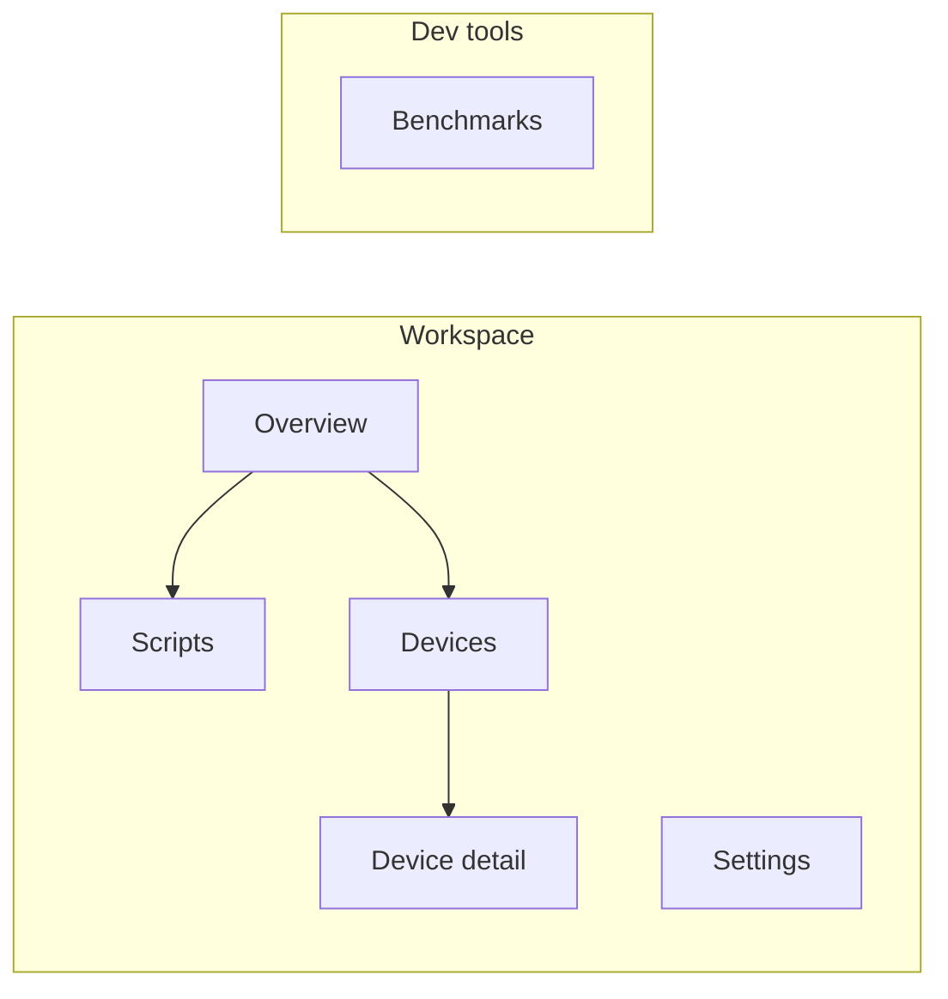

# Current HAR desktop UI

The desktop app (`desktop/`, Tauri + React + Vite) is a script-first console: you run Python
on any of your computers and see where it ran, what it printed, and how it ended. Benchmarks
are a dev tool, not the home screen.

## Pages



| Page | What it shows | Main actions |
|---|---|---|
| **Overview** | Running scripts (live elapsed time), one row per computer with its backends, recent scripts, PyTorch version | New script, Stop |
| **Scripts** | Run history beside the selected run (stacked below 1280 px): computer, start, duration, result, live output, timing and hardware (folded) | New script, Stop, Copy output |
| **Devices** | One card per computer, one row per backend with memory; role summary; worker connection and trusted hosts in Worker role | Add device (host only), Details, Disconnect |
| **Device detail** | Backends, what is running there now, OS/CPU/memory/Python/PyTorch, Python packages (compared with this host for a worker) | Rename, Disconnect, Check again |
| **Settings** | Role (Host / Worker / Standalone), PyTorch status, About (app version, Python, MPS/CUDA, API address, environment hash) | Switch role, Install / Repair / Reinstall PyTorch |
| **Benchmarks** | Matrix multiply, image model and tree traversal runs; selected run's metrics and trace | Start benchmark |

First launch shows a setup screen until PyTorch is installed (or skipped).

## Behaviour worth knowing

- **One poll.** `RuntimeProvider` fetches `/api/runtime` and `/api/scripts?include_output=false`
  every 3 s (skipped while a request is in flight or the window is hidden). Worker-only
  endpoints are fetched only in Worker role. Slow calls (`runtime_status`, env checks) run when
  their page opens, never on the poll.
- **Live output** streams over SSE, resumes from the last chunk after a drop, and falls back to
  polling after 3 failed connections. It auto-scrolls only while you're at the bottom.
- **Stop** sends Ctrl-C to the script's process group, then force-stops it after 2 s. The run
  ends as `stopped`, not `failed`.
- **Restarts** (role switch, PyTorch install) stop running scripts; the UI asks first and shows
  "HAR is restarting" instead of a connection error.
- **Browser mode** (`npm run dev` against `har serve`): everything except role switching and
  PyTorch install works; those say so.

## Code layout

```
desktop/src/
  main.jsx, App.jsx   mount; setup gate → providers → shell → page + modal host
  app/                RuntimeProvider (the poll), Navigation, Toast, Confirm, Sidebar, Topbar
  api/                client.js (request, ApiError), endpoints.js (every endpoint)
  lib/                devices.js (wording, computers), runs.js (statuses, labels), format.js, tauri.js
  hooks/              useScriptStream, useStopScript, useAction, useNow
  components/         Button, IconButton, Modal, ConfirmDialog, Field, MemoryBar, ScriptOutput, icons…
  views/              overview/, scripts/, devices/, settings/, benchmarks/, setup/
  styles/             index.css imports tokens → base → panel → layout → components → views
```

`npm run lint` must pass: it is what catches a component used without an import after a move.
